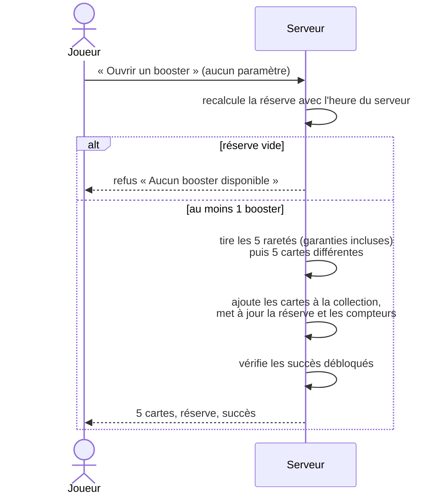

# 2. Boosters

## Régénération

- Un nouveau booster arrive toutes les **30 minutes** (`BOOSTER_REGEN_MINUTES`).
- La réserve est plafonnée à **10 boosters** (`BOOSTER_MAX`).
- **Quand la réserve est pleine, le compteur s'arrête.** Il repart dès qu'on ouvre un booster. On ne « perd » donc rien à ouvrir, mais on perd du temps de régénération en laissant la réserve pleine.
- À partir d'une réserve vide, il faut 5 heures pour la remplir. C'est le rythme que vise le jeu : deux ou trois visites par jour.

Dans l'en-tête et sur la page Boosters, le joueur voit :

- le nombre de boosters disponibles (« 7/10 ») ;
- le temps restant avant le prochain booster, avec une barre de progression, ou « réserve pleine » ;
- les **garanties** en cours (« Épique garantie dans 4 boosters », « Légendaire garantie dans 37 »).

La **récompense quotidienne** offre aussi des boosters (1, 2 ou 3 selon le jour), qui s'ajoutent à la réserve **même au-delà de 10**. Voir [Récompenses](12-recompenses.md).

Une **notification** (si le joueur l'a activée) prévient quand la réserve vient d'être remplie. Une seule notification est envoyée par remplissage, et aucune toutes les 30 minutes.

## Ouverture

1. Le joueur touche un booster (ou le bouton « Ouvrir un booster »).
2. Le booster tremble ; le joueur le touche pour le **déchirer**.
3. Les cartes apparaissent face cachée. Le dos d'une carte **Rare, Épique ou Légendaire brille** et pulse avant d'être retourné : le suspense fait partie du plaisir.
4. Révélation :
   - **sur téléphone**, carte par carte : on touche pour retourner la carte, puis on glisse ou on touche pour passer à la suivante. Le téléphone vibre sur les cartes rares (Android) ;
   - **sur ordinateur**, les 5 cartes en ligne, à retourner une par une ou toutes d'un coup (« Tout révéler »).
5. Récapitulatif : nombre de nouvelles cartes, points gagnés, puis les boutons « Ouvrir un autre booster », « Voir ma collection » et « Fermer ».
6. Les **succès** débloqués s'affichent en notification.

Les cartes reçues sont ajoutées à la collection. Un doublon augmente simplement le nombre d'exemplaires (×2, ×3…).

## Contenu d'un booster

| Emplacement | Raretés possibles |
| --- | --- |
| Cartes 1 à 4 | Toutes, selon les probabilités « normales » |
| Carte 5 (vedette) | Peu commune ou mieux |

Un même booster ne contient jamais deux fois la même carte, sauf si le catalogue est trop petit pour l'éviter.

Les probabilités détaillées sont dans [Cartes et raretés](03-cartes-et-raretes.md).

## Garanties (« pity »)

Le hasard pur peut être cruel : une simulation de 200 000 boosters sans garantie montrait jusqu'à **39 boosters d'affilée sans Épique** et **plus de 200 sans Légendaire**. Pour éviter ces séries frustrantes :

- **Épique garantie** : si aucun des 9 derniers boosters n'a contenu d'Épique ou de Légendaire, le 10ᵉ en contient une (`PITY_EPIC=10`). Elle est Légendaire une fois sur cinq.
- **Légendaire garantie** : si aucun des 59 derniers boosters n'a contenu de Légendaire, le 60ᵉ en contient une (`PITY_LEGENDARY=60`).

La garantie ne s'applique que si le tirage normal ne l'a pas déjà satisfaite. Le compteur repart à zéro dès qu'une carte de la rareté visée sort, que ce soit naturellement ou grâce à la garantie. Seuls les boosters comptent : les cartes gagnées en boutique, à la bourse ou dans les mini-jeux ne remettent pas le compteur à zéro.
