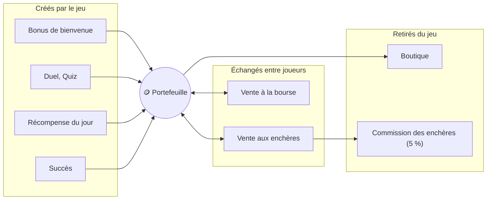

# 7. Crédits et économie

Les **crédits (🪙)** sont la monnaie du jeu. Le solde est affiché en permanence dans l'en-tête, et l'historique des derniers mouvements se trouve sur le profil.

Chaque mouvement passe par le **portefeuille** du serveur : il refuse tout solde négatif et inscrit chaque opération au journal, avec le solde obtenu.

## D'où viennent les crédits (sources)

| Source | Montant | Limite |
| --- | --- | --- |
| Bonus de bienvenue | 100 | une fois, à l'inscription (`STARTING_CREDITS`) |
| Duel de stats | 10 par bonne réponse | 3 parties par jour |
| Quiz auto | 15 par bonne réponse | 3 parties par jour |
| Vente à la bourse | prix fixé par le vendeur | payé par un autre joueur |
| Vente aux enchères | meilleure offre − 5 % de commission | payée par un autre joueur |
| Récompense quotidienne | 50 à 200 (jours 1, 3, 5 et 7 du cycle) | une fois par jour |
| Succès | 50 / 150 / 400 / 1 000 selon le palier | une fois par succès (11 400 au total) |

## Où partent les crédits (dépenses)

| Dépense | Montant |
| --- | --- |
| Boutique | de 40 à 4 000 selon la rareté (voir [Boutique](08-boutique.md)) |
| Achat à la bourse | prix fixé par le vendeur |
| Enchère remportée | montant de la meilleure offre (bloqué dès l'offre, rendu si surenchéri) |
| Commission des enchères | 5 % du prix de vente, **détruits** |

## Principes d'équilibre

- **Pas de transfert déguisé entre comptes** : la bourse et les enchères ne sont ouvertes qu'aux comptes de plus de 24 heures ayant ouvert au moins 3 boosters. Les prix ne peuvent pas descendre sous un plancher par rareté, et les échanges carte contre carte se font entre raretés proches. Voir [Bourse](09-bourse-echanges.md#garde-fous).

- **Création monétaire limitée** : les seules sources de crédits « neufs » sont le bonus de bienvenue et les deux jeux à crédits, plafonnés par le nombre de parties par jour (525 crédits par jour au maximum). Les jeux rapides donnent des **cartes**, pas de crédits : ils n'alimentent pas l'inflation. Les échanges de la bourse ne font que **déplacer** des crédits entre joueurs, sans en créer.
- **Les puits** : la boutique (les crédits dépensés disparaissent) et la commission de 5 % des enchères. L'inflation reste ainsi contenue malgré les récompenses.
- **Les récompenses suivent l'assiduité** (série de jours) et la progression (succès), pas le temps passé : elles donnent de quoi enchérir sans encourager à jouer des heures.
- **Les bots** apportent de la liquidité au lancement : ils achètent les cartes des joueurs avec leurs propres crédits. Voir [Bots](13-bots.md).
- **Les prix suivent la rareté** : une Commune coûte 40 crédits (une partie de duel moyenne), une Légendaire 4 000 crédits (environ deux semaines de jeu assidu). La boutique permet de **cibler** une rareté sans court-circuiter les boosters.
- **La boutique donne des repères de prix à la bourse** : quand un joueur crée une offre contre des crédits, le prix proposé par défaut est d'environ 75 % du prix boutique de la rareté (30, 90, 300, 900, 3 000). C'est cohérent : la bourse permet de choisir sa carte précise, la boutique non.

## Journal des mouvements

Chaque mouvement est enregistré : date, montant, motif (« Duel de stats », « Achat en boutique », « Vente à la bourse »…), objet concerné et solde après opération. Le joueur voit ses 8 derniers mouvements sur son profil. Ce journal sert aussi d'outil d'audit en cas de litige ou de suspicion de triche.

## Leviers de réglage

Tous ces paramètres se règlent sans toucher au code : `STARTING_CREDITS`, `GAMES_PER_DAY`, gains par bonne réponse (`economyConfig` dans `apps/api/src/config.ts`), prix de la boutique (`SHOP_RULES` dans `apps/api/src/modules/marketplace/domain/shop-rotation.ts`).
