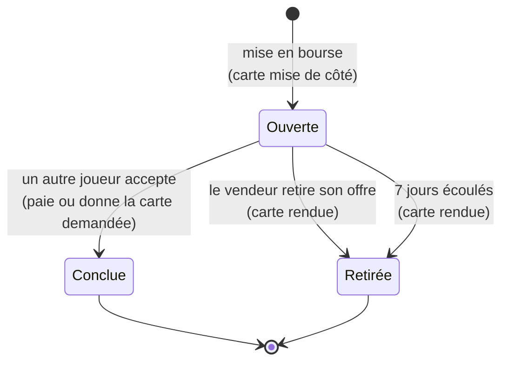

# 9. Bourse d'échanges

La bourse est une **place de marché ouverte à tous les joueurs**. On y propose une de ses cartes, généralement un doublon, en échange :

- **d'une carte précise** (« ma Mustang contre ta 2CV »), ou
- **d'un montant de crédits** fixé par le vendeur.

Pas besoin d'être amis : toute offre ouverte est visible et acceptable par n'importe quel joueur. Au lancement, des [bots](13-bots.md) 🤖 publient et acceptent aussi des offres. Pour une carte très demandée, préférez les [enchères](11-encheres.md).

## Proposer une carte

1. « + Proposer une carte » (ou « 🤝 Proposer à l'échange » depuis la fiche d'une carte).
2. Choisir la carte proposée parmi sa collection. Un avertissement s'affiche si c'est le **dernier exemplaire**.
3. Choisir la contrepartie :
   - **🪙 Crédits** : un prix est suggéré selon la rareté et reste modifiable ;
   - **🎴 Une carte** : choisie dans tout le catalogue, avec une recherche.
4. « Publier l'offre ».

**Séquestre** : la carte proposée **quitte la collection** tant que l'offre est ouverte. On ne peut donc pas la proposer deux fois ni la vendre en double. Elle revient si l'offre est retirée ou expire.

Limites : **10 offres ouvertes** par joueur au maximum (`MAX_OPEN_TRADES`), et **7 jours** de validité par offre (`TRADE_DAYS`).

## Parcourir les offres

Trois onglets :

| Onglet | Contenu |
| --- | --- |
| Toutes | Toutes les offres des autres joueurs, les plus récentes d'abord |
| Pour moi | Les offres **intéressantes et accessibles** : la carte proposée me manque, **et** je possède la carte demandée ou j'ai assez de crédits |
| Mes offres | Mes offres ouvertes (« 3/10 offres ouvertes »), avec un bouton « Retirer » |

Filtres : recherche par nom ou marque de la carte proposée, et rareté.

Chaque offre affiche la carte proposée, la contrepartie (carte ou prix), le pseudo du vendeur et le délai avant expiration. Des repères aident à décider : « Vous ne l'avez pas » sur la carte proposée, « Vous l'avez ×2 » sur la carte demandée.

## Accepter une offre

- Le bouton « Accepter » n'est actif que si l'on peut honorer l'offre. Sinon, il indique « Carte requise » ou « Crédits insuffisants ».
- L'échange est **immédiat et atomique** : les deux cartes (ou la carte et les crédits) changent de main en une seule opération. Il ne peut pas y avoir d'échange à moitié fait.
- Si deux joueurs acceptent la même offre au même instant, **un seul** l'obtient. L'autre reçoit « Cette offre n'est plus disponible ».
- Le vendeur reçoit une **notification** (« Échange conclu 🤝 ») s'il les a activées.
- Les succès d'échange sont vérifiés pour **les deux** joueurs.

## Retrait et expiration

- Le vendeur peut **retirer** son offre à tout moment, et la carte revient dans sa collection.
- Au bout de 7 jours, l'offre **expire** : elle disparaît de la bourse et la carte est rendue automatiquement (vérification toutes les 10 minutes et au démarrage du serveur).

## Vie d'une offre

## Garde-fous

- **Accès au marché** : un compte doit avoir au moins **24 heures** et avoir ouvert au moins **3 boosters** pour vendre, acheter ou enchérir. Les bots en sont dispensés. Cela empêche de créer des comptes jetables pour transférer leurs cartes et crédits de bienvenue vers un compte principal.
- **Prix plancher** selon la rareté : 5 (Commune), 15 (Peu commune), 50 (Rare), 150 (Épique), 500 (Légendaire) crédits. Impossible donc de « donner » une Légendaire pour 1 crédit.
- **Échange carte contre carte** : les deux cartes doivent être de raretés proches (au plus un cran d'écart, par exemple Rare contre Épique).
- On ne peut pas accepter sa propre offre.
- On ne peut pas échanger une carte contre elle-même.
- Une carte demandée doit exister dans le catalogue actif.
- Prix entre 1 et 1 000 000 crédits.
