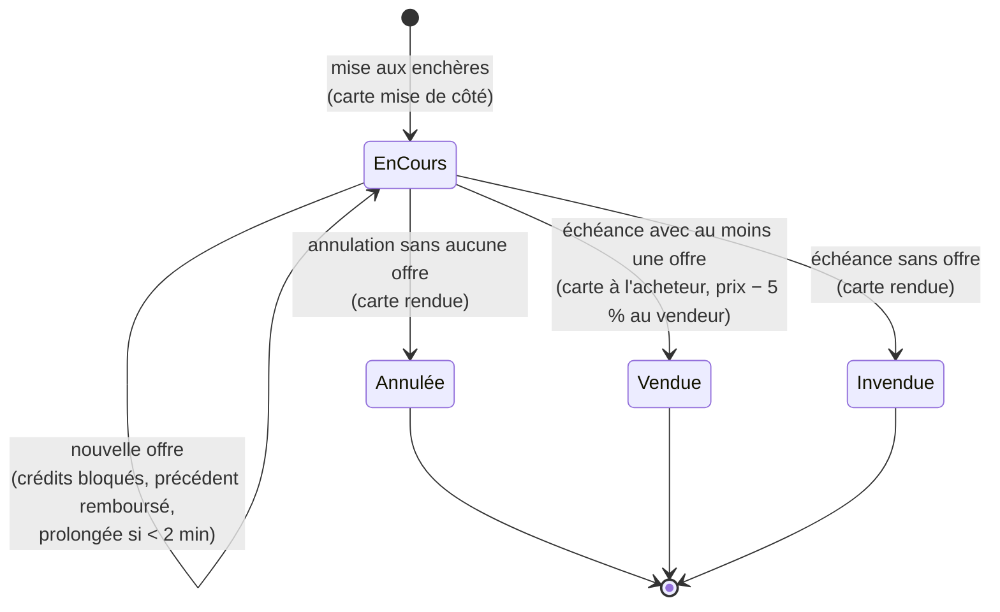
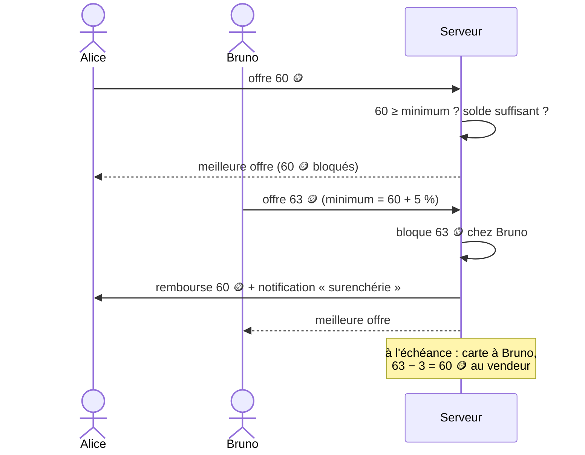

# 11. Enchères

Les enchères complètent la [bourse d'échanges](09-bourse-echanges.md). À la bourse, le vendeur fixe un prix et le premier qui accepte l'emporte. Aux enchères, le vendeur fixe une **mise à prix** et une **durée**, et la carte part au **meilleur enchérisseur** à la fin. C'est idéal pour les cartes recherchées, dont la valeur est difficile à estimer.

Elles se trouvent dans **Marché > 🔨 Enchères**, avec trois vues : « En cours », « Mes offres » et « Mes ventes ».

## Mettre une carte aux enchères

1. « + Mettre aux enchères », ou « 🔨 Mettre aux enchères » depuis la fiche d'une carte.
2. Choisir la carte. Un avertissement s'affiche s'il s'agit du dernier exemplaire.
3. Fixer la **mise à prix**. La valeur suggérée est la moitié du prix boutique de la rareté : 20, 60, 200, 600 ou 2 000 crédits.
4. Choisir la **durée** : 1, 3, 6, 12 ou 24 heures.

La carte est **mise sous séquestre** pendant toute la durée de l'enchère : elle quitte la collection et ne peut être ni vendue ailleurs ni échangée. On peut avoir **5 enchères en cours** au maximum (`MAX_OPEN_AUCTIONS`).

Une enchère peut être **annulée tant que personne n'a enchéri**. La carte revient alors dans la collection.

## Enchérir

- L'offre minimale est la **mise à prix**, puis la meilleure offre **+5 %** (au moins 1 crédit). Le champ de saisie est prérempli avec ce minimum.
- Les crédits de l'offre sont **prélevés immédiatement** (« bloqués »). Le solde affiché le reflète : impossible de promettre des crédits qu'on n'a pas.
- Dès que quelqu'un **surenchérit**, l'ancien meilleur enchérisseur est **remboursé intégralement**, au même instant, et reçoit une notification (« Vous avez été surenchéri ⚠️ »).
- On ne peut pas surenchérir sur sa propre offre, ni enchérir sur sa propre vente.
- **Anti « dernière seconde »** : une offre arrivant dans les **2 dernières minutes** repousse la fin de l'enchère à 2 minutes. Tout le monde a donc le temps de répondre.

## Fin de l'enchère

La clôture est automatique (vérification toutes les 30 secondes) :

| Situation | Résultat |
| --- | --- |
| Au moins une offre | La carte part au meilleur enchérisseur. Le vendeur reçoit le montant **moins 5 % de commission** (`AUCTION_FEE_PERCENT`). Les deux reçoivent une notification. |
| Aucune offre | La carte revient au vendeur |

La commission de 5 % est un **puits de crédits** : elle sort de l'économie et limite l'inflation, comme les achats en boutique.

## Vie d'une enchère

## Garde-fous

- Mêmes règles d'accès que la bourse : compte de plus de **24 heures** ayant ouvert au moins **3 boosters**, pour vendre comme pour enchérir.
- **Mise à prix minimale** selon la rareté (5, 15, 50, 150, 500 crédits).
- Montants entiers, entre la mise à prix ou l'offre minimale et 10 000 000 ; jamais au-delà de son solde.

## Affichage

Chaque enchère montre la carte (avec « Vous ne l'avez pas » si elle manque à la collection), le **compte à rebours** (en rouge dans les 5 dernières minutes), le prix actuel et le nombre d'offres, le meilleur enchérisseur et le vendeur. Les **bots** sont signalés par 🤖. La liste se met à jour toutes les 15 secondes pour voir arriver les nouvelles offres.

## Succès liés

« Adjugé ! » (remporter une enchère), « Collectionneur averti » (en remporter 10), « Commissaire-priseur » (vendre 5 cartes aux enchères).
