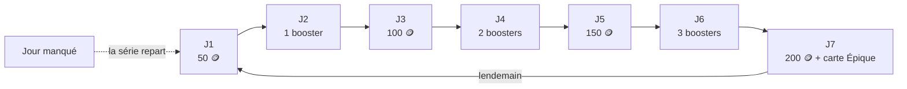

# 12. Récompenses régulières

Pour enchérir et acheter, il faut des crédits. En plus des mini-jeux, trois mécanismes en distribuent régulièrement, et récompensent l'assiduité plutôt que le temps passé.

## Récompense quotidienne (jours consécutifs)

Un calendrier de 7 jours s'affiche en haut de la page **Boosters**. Une fois par jour, le joueur touche « Récupérer » :

| Jour | Récompense |
| --- | --- |
| J1 | 50 crédits |
| J2 | 1 booster |
| J3 | 100 crédits |
| J4 | 2 boosters |
| J5 | 150 crédits |
| J6 | 3 boosters |
| J7 | 200 crédits + **1 carte Épique** (Légendaire une fois sur cinq) |

- Les jours s'enchaînent tant que le joueur revient **chaque jour** (minuit, heure de Paris). **Un jour manqué fait repartir la série au jour 1.**
- Après le 7ᵉ jour, le cycle recommence au jour 1, mais la **série continue de compter** (8, 9, 10… jours) pour les succès.
- Les boosters offerts s'ajoutent à la réserve, **même au-delà de 10**. Ils ne sont pas perdus si la réserve est pleine.
- Une semaine complète rapporte 500 crédits, 6 boosters et 1 carte Épique ou mieux.

Succès liés : « Bonne habitude » (3 jours d'affilée), « Habitué du garage » (7 jours), « Fidèle au poste » (30 jours).

## Récompenses des succès

Chaque succès débloqué **verse automatiquement des crédits** selon son palier : 50 (bronze), 150 (argent), 400 (or), 1 000 (platine). Les 45 succès rapportent 11 400 crédits au total, étalés sur toute la vie du joueur : les premiers arrivent dès les premières minutes, les derniers après des mois. Voir [Succès et badges](05-succes-et-badges.md).

## Mini-jeux

Les jeux à crédits (Duel de stats, Quiz auto) rapportent des crédits à chaque bonne réponse, et les jeux rapides des cartes. Voir [Mini-jeux](06-mini-jeux.md).

## Ordre de grandeur pour un joueur régulier

| Source | Par jour | Par semaine |
| --- | --- | --- |
| Récompense quotidienne | ~70 🪙 en moyenne (+ boosters, carte Épique le 7ᵉ jour) | 500 🪙 |
| Mini-jeux à crédits | 150 à 270 🪙 | 1 000 à 1 900 🪙 |
| Succès | très variable : beaucoup au début, puis de temps en temps | — |

Assez pour une carte Rare de la boutique (400) tous les deux jours, ou pour une enchère disputée sur une Épique en fin de semaine.
