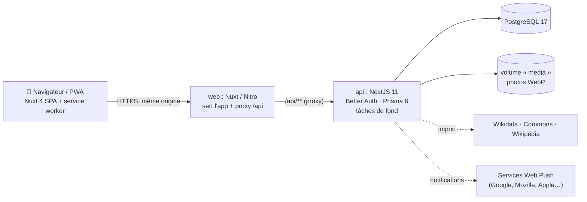
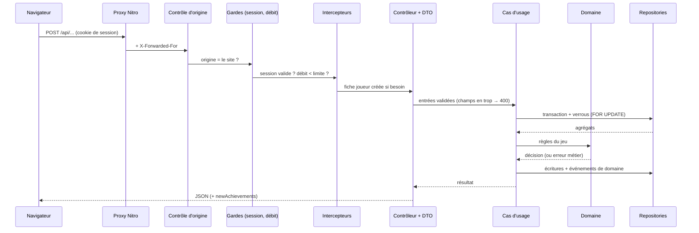

# 1. Architecture et choix techniques

## Vue d'ensemble



Trois conteneurs Docker : `db` (PostgreSQL), `api` (NestJS) et `web` (Nuxt). Seul `web` est exposé.

## Organisation du dépôt

```
apps/
  api/                       NestJS
    prisma/                  schéma + migrations
    src/
      shared/                noyau partagé : erreurs métier, Credits, événements, transactions (CLS),
                             verrous joueur, horloge, aléatoire, filtre d'erreurs, limitation de débit
      modules/               un module NestJS par contexte métier (DDD + hexagonal) :
        identity/            Better Auth, garde global, décorateurs
        player/              création de la fiche joueur, profil /me
        wallet/              solde et journal des crédits
        catalog/             cartes, raretés, import Wikidata, photos, résumés
        collection/          cartes possédées, boosters, tirage, garanties
        statistics/          statistiques d'un joueur (lecture)
        progression/         succès et récompenses, récompense quotidienne
        games/               mini-jeux
        marketplace/         boutique, bourse d'échanges, enchères
        notifications/       Web Push
        bots/                joueurs automatiques
          (chaque module : domain/ · application/ · infrastructure/ · http/)
      cli/                   commande d'import
    test/e2e/                tests de bout en bout (vraie API, base temporaire)
  web/                       Nuxt 4
    app/pages/               écrans
    app/components/          cartes, boosters, marché…
    app/composables/         API, session, joueur, PWA, notifications
    server/routes/api/       proxy vers l'API
    public/                  manifeste, service worker, icônes
docs/                        cette documentation
docker-compose.yml
```

## Choix techniques et justifications

| Choix | Pourquoi | Alternatives écartées |
| --- | --- | --- |
| **NestJS 11** | Demandé ; structure modulaire claire, injection de dépendances, validation intégrée | NestJS 12, plus récent mais encore moins éprouvé au moment du développement |
| **Prisma 6** | Schéma lisible, migrations versionnées, types générés, adaptateur officiel Better Auth | Prisma 7/8 (nouveau générateur, adaptateurs obligatoires), Drizzle |
| **PostgreSQL** | Demandé ; transactions et verrous de ligne (`FOR UPDATE`) indispensables pour l'économie | — |
| **Better Auth** | Bibliothèque prête à l'emploi : sessions en base, hachage des mots de passe, limitation de débit, plugins OAuth et 2FA pour plus tard | Passport + JWT maison (plus de code sensible à écrire), service externe (dépendance et coût) |
| **Nuxt 4, mode SPA** | Demandé (Vue + Nuxt) ; jeu derrière une connexion, donc le référencement n'est pas un enjeu, et le rendu serveur n'apporterait que de la complexité | Rendu serveur (SSR), qui obligerait à transmettre la session côté serveur |
| **Proxy `/api` dans Nitro** | Une seule origine : cookies first-party, pas de CORS, pas de problème de cookies tiers sur Safari | API exposée sur un autre domaine |
| **PWA plutôt qu'appli native** | Une seule base de code, installation sans store, notifications push ; enveloppable plus tard avec Capacitor | React Native ou Flutter (deuxième base de code) |
| **CSS fait main** | Les cartes demandent un CSS spécifique (holographie, `container queries`, 3D) ; pas de framework à apprendre | Tailwind |
| **DDD et architecture hexagonale** (`src/modules/*/domain`) | Règles du jeu dans des agrégats et fonctions pures, testables sans base ; un module par contexte métier ; dépendances vers l'intérieur uniquement. Détail : [Architecture DDD](13-architecture.md) | Services « fourre-tout » qui mélangent HTTP, règles et SQL |
| **Tâches de fond par `setInterval`** dans l'API | Suffisant pour une instance unique ; aucune infrastructure en plus | File de tâches (BullMQ et Redis) : à prévoir pour plusieurs instances, voir [Évolutions](11-evolutions.md) |
| **Photos stockées localement en WebP** | Indépendance vis-à-vis de Wikimedia, performances, hors-ligne, respect de leur politique robots | Liens directs vers Wikimedia (fragile, et soumis à leurs limites) |

## Flux d'une requête

1. Le navigateur appelle `/api/boosters/open` sur l'origine du site.
2. Nitro (conteneur `web`) **proxifie** la requête vers `http://api:3001/api/boosters/open`. Il transmet les cookies et ajoute `X-Forwarded-For` (l'IP du joueur, pour la limitation de débit).
3. Dans NestJS, le **garde global** `AuthGuard` valide la session Better Auth (cookie signé, cache court) et place l'utilisateur dans la requête.
4. La limitation de débit par joueur s'applique. La fiche joueur est créée si besoin.
5. Le **contrôleur** (`http/`) valide les entrées. Tout champ non prévu est refusé. Il appelle ensuite le **cas d'usage** (`application/`).
6. Le cas d'usage ouvre une **unité de travail** (transaction portée par le contexte), **verrouille** le joueur (`SELECT … FOR UPDATE`) et charge les **agrégats** (`domain/`), qui appliquent les règles. Il enregistre ensuite via les repositories (`infrastructure/`) et publie des **événements de domaine**.
7. Les abonnés aux événements agissent dans la même transaction (succès et leurs récompenses), puis après validation (notifications push). Les succès débloqués sont ajoutés à la réponse (`newAchievements`).



Voir l'exemple complet dans [Architecture DDD](13-architecture.md#exemple--ouverture-dun-booster).

Les routes `/api/auth/*` sont traitées directement par le gestionnaire Better Auth, monté avant l'analyse du corps JSON. Les photos `/api/media/*` sont servies en fichiers statiques avec un cache d'un an.

## Fuseau horaire

Les journées de jeu (parties de mini-jeux, programme de la boutique) suivent `GAME_TIMEZONE` (par défaut `Europe/Paris`). Ce calcul se fait sans bibliothèque, avec l'API `Intl`, et gère les changements d'heure (`src/shared/domain/zoned-time.ts`, testé).
