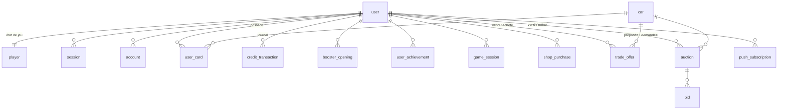
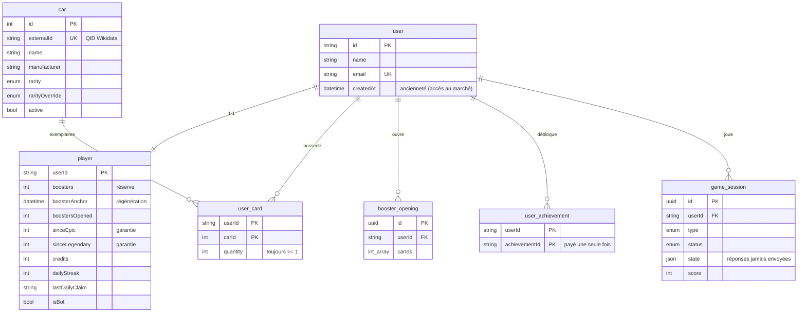
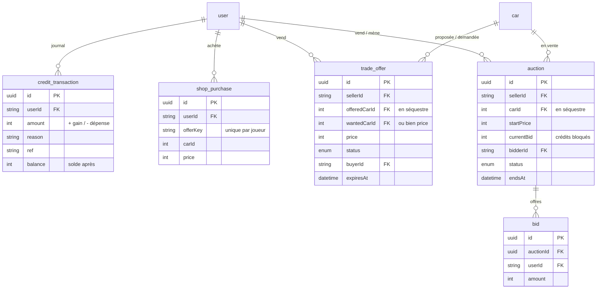

# 2. Modèle de données

Le schéma complet, commenté, se trouve dans `apps/api/prisma/schema.prisma`. Les migrations sont versionnées dans `apps/api/prisma/migrations/` et appliquées au démarrage du conteneur (`prisma migrate deploy`).

## Schéma

### Vue d'ensemble

### Joueur, collection et progression

### Économie et marché

Tables par contexte (chaque contexte n'écrit que ses tables, ou ses colonnes de `player`) :

| Contexte | Tables / colonnes |
| --- | --- |
| `identity` | `user`, `session`, `account`, `verification` (Better Auth) |
| `wallet` | `player.credits`, `player.creditsEarned`, `credit_transaction` |
| `collection` | `user_card`, `booster_opening`, `player.boosters`, `boosterAnchor`, `boostersOpened`, `cardsObtained`, `sinceEpic`, `sinceLegendary` |
| `progression` | `user_achievement`, `player.dailyStreak`, `bestStreak`, `lastDailyClaim` |
| `games` | `game_session`, `player.gamesPlayed`, `gameCardsWon`, `doorsJackpots` |
| `marketplace` | `shop_purchase`, `trade_offer`, `auction`, `bid`, `player.shopPurchases`, `tradesCompleted`, `auctionsWon`, `auctionsSold` |
| `catalog` | `car` |
| `notifications` | `push_subscription`, `player.fullNotifiedAnchor` |
| `bots` | `player.isBot`, `botProfile`, `botNextActionAt` |

## Tables

### Authentification (format imposé par Better Auth)

`user`, `session`, `account` (le mot de passe haché est dans `account.password`), `verification`.

### `car`, le catalogue

| Colonne | Rôle |
| --- | --- |
| `externalId` | QID Wikidata (`Q172146`) ou `seed:<slug>` pour le jeu de secours |
| `name`, `manufacturer`, `country`, `yearStart`, `yearEnd` | Identité |
| `powerKw`, `topSpeedKmh`, `massKg`, `lengthMm` | Caractéristiques (souvent partielles) |
| `racing` | Voiture de course |
| `popularity` | Nombre de Wikipédias ayant un article (sert à calculer la rareté) |
| `rarity`, `rarityOverride` | Rareté calculée / forcée manuellement (la seconde l'emporte) |
| `wikiTitle`, `wikiLang`, `summary`, `summaryFetchedAt` | Article et résumé Wikipédia |
| `imageFile` | Nom du fichier sur Commons |
| `imagePath` | Copie locale (relative à `MEDIA_DIR`) |
| `imageUrl` | Image distante, utilisée en repli |
| `imageAuthor`, `imageLicense`, `imageLicenseUrl` | Crédits de la photo |
| `imageCheckedAt` | Dernière tentative de téléchargement |
| `active` | Carte présente dans le jeu |

### `player`, l'état de jeu

| Colonne | Rôle |
| --- | --- |
| `boosters`, `boosterAnchor` | Réserve et ancre du minuteur (voir [Moteur de jeu](04-moteur-de-jeu.md)) |
| `fullNotifiedAnchor` | Évite de notifier deux fois le même remplissage |
| `sinceEpic`, `sinceLegendary` | Compteurs de garantie |
| `credits`, `creditsEarned` | Solde et cumul gagné (hors bonus de bienvenue) |
| `boostersOpened`, `cardsObtained`, `gamesPlayed`, `tradesCompleted`, `shopPurchases`, `gameCardsWon`, `doorsJackpots`, `auctionsWon`, `auctionsSold` | Compteurs pour les statistiques et les succès |
| `dailyStreak`, `bestStreak`, `lastDailyClaim` | Récompense quotidienne : série en cours, meilleure série, dernier jour réclamé (`AAAA-MM-JJ`, fuseau du jeu) |
| `isBot`, `botProfile`, `botNextActionAt` | Bots : drapeau, personnalité (JSON), prochain passage |

La ligne `player` est créée à la première requête du joueur (`upsert`), avec 10 boosters et 100 crédits.

### Collection et historique

- `user_card (userId, carId)` : **une ligne par carte possédée**, avec `quantity ≥ 1`. La ligne est supprimée quand la quantité tombe à 0 : toute ligne présente signifie donc « possédée ».
- `booster_opening` : identifiants des cartes tirées, avec la date.
- `user_achievement (userId, achievementId)` : succès débloqués. Les définitions sont dans le code, pas en base.

### Économie

- `credit_transaction` : `amount` (positif ou négatif), `reason` (`game:duel`, `game:quiz`, `shop`, `trade:sale`, `trade:purchase`), `ref` (identifiant de l'objet concerné), `balance` (solde après opération).
- `game_session` : `type` (DUEL, QUIZ, WEIGHT, MYSTERY, DOORS), `status`, `round`, `score`, `credits`, `rewardCarId`, et `state` (JSON) qui contient la question en cours **avec sa réponse** (jamais renvoyée au client) et les cartes déjà utilisées.
- `shop_purchase` : `offerKey` (unique par joueur, ce qui empêche le double achat), `carId`, `price`.
- `trade_offer` : `offeredCarId`, `wantedCarId` **ou** `price`, `status` (OPEN, COMPLETED, CANCELLED), `buyerId`, `expiresAt`.
- `auction` : `carId` (en séquestre), `startPrice`, `currentBid` et `bidderId` (meilleure offre, crédits déjà prélevés), `bidCount`, `status` (OPEN, SOLD, UNSOLD, CANCELLED), `endsAt` (repoussé par l'anti « dernière seconde »).
- `bid` : historique de toutes les offres (`auctionId`, `userId`, `amount`).

### Notifications

`push_subscription` : un appareil par ligne (`endpoint` unique et clés de chiffrement).

## Invariants garantis par le code

| Invariant | Mécanisme |
| --- | --- |
| Un booster ne peut pas être ouvert deux fois | Verrou `FOR UPDATE` sur `player` |
| Le solde ne devient jamais négatif | Objet-valeur `Credits` dans l'agrégat `Wallet`, sous verrou joueur, avec contrôle de concurrence optimiste à l'écriture |
| Chaque mouvement de crédits est journalisé | `WalletService` (agrégat `Wallet`) est le seul point d'écriture de `credits` ; vérifié par les tests de bout en bout (solde = départ + journal) |
| Une carte en bourse n'existe qu'une fois | Séquestre : retirée de `user_card` à la publication |
| Une offre n'est acceptée qu'une fois | Verrou `FOR UPDATE` sur `trade_offer` + vérification du statut |
| Les crédits d'une enchère ne sont jamais dépensés deux fois | Prélevés à l'offre, rendus au surenchéri dans la même transaction (verrou sur `auction` et sur les deux joueurs) |
| Un succès ne paie qu'une fois | `INSERT … ON CONFLICT DO NOTHING RETURNING` : la récompense n'est versée que si la ligne a été insérée |
| La récompense du jour n'est réclamée qu'une fois | Verrou joueur + comparaison de `lastDailyClaim` avec la date du jour |
| Une offre de boutique n'est achetée qu'une fois par joueur | Contrainte d'unicité `(userId, offerKey)` |
| Une manche de mini-jeu n'est jouée qu'une fois | Verrou `FOR UPDATE` sur `game_session` |
| Pas d'interblocage entre deux joueurs | Verrous toujours pris dans l'ordre des identifiants (`PlayerLocks`) ; offre ou enchère verrouillée avant les joueurs |
