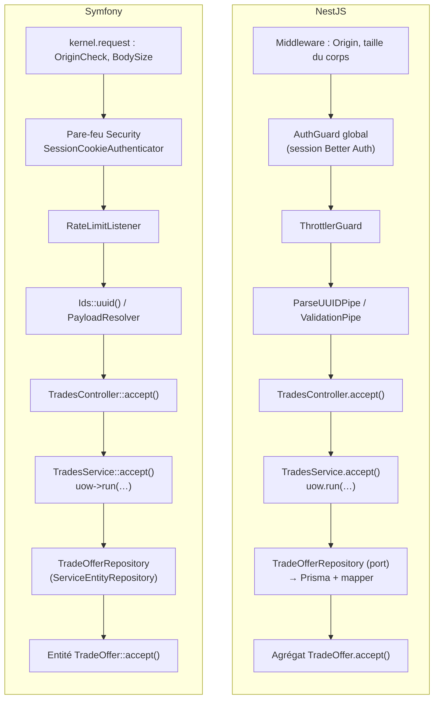
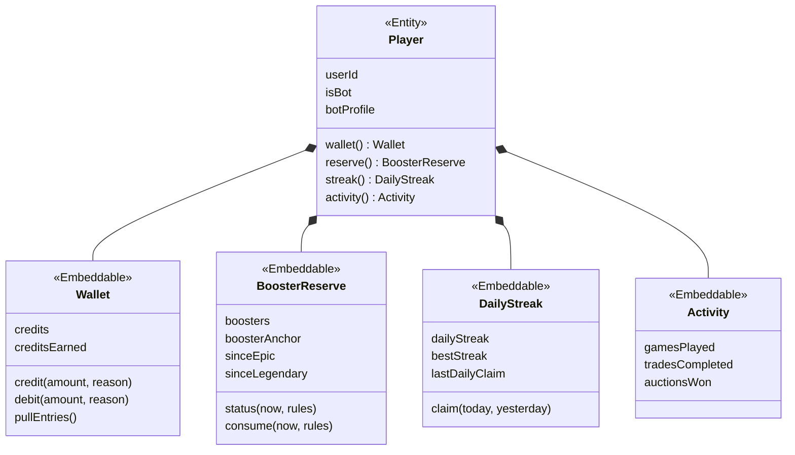
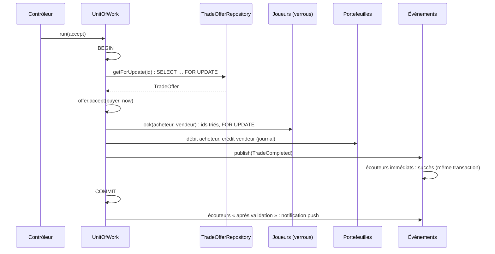
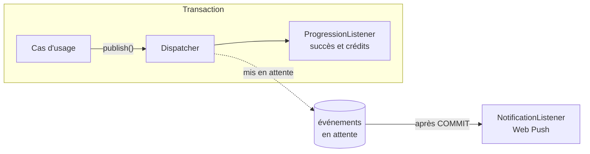
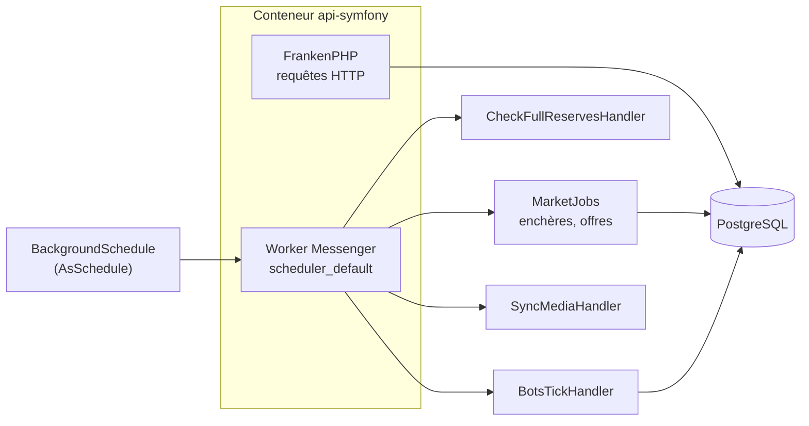

# 14. Backend Symfony : comparaison avec NestJS

Le dépôt contient deux implémentations de la même API :

- `apps/api` : NestJS 11, Prisma 6, Better Auth (le backend de référence) ;
- `apps/api-symfony` : PHP 8.3, Symfony 7.4 LTS, Doctrine ORM 3.

Elles sont **interchangeables** pour le front Nuxt : même schéma de base, mêmes routes, mêmes réponses JSON, mêmes codes d'erreur, mêmes règles anti-triche, mêmes variables d'environnement. Cette page compare leur architecture : entités, contrôleurs, repositories, transactions, événements, tâches de fond et tests.

> Les deux backends passent **la même suite de 48 tests de bout en bout** (`npm run test:e2e` et `npm run test:e2e:symfony` dans `apps/api`). Un test PHPUnit vérifie aussi que la boutique de Symfony produit exactement le même programme que celle de NestJS pour un même secret.

## Ce qui est identique

| Élément | Garantie |
| --- | --- |
| Schéma PostgreSQL | La migration Doctrine `Version20261028000000` est générée à partir du DDL Prisma : mêmes tables, colonnes camelCase, types ENUM, `timestamp(3)`, `jsonb`, `int[]`, index et clés étrangères |
| Routes et JSON | Même préfixe `/api`, mêmes chemins et codes HTTP (201 à la création, 204 sans contenu), mêmes clés et formats (dates ISO `2026-10-29T00:33:17.123Z`) |
| Erreurs | Même corps `{statusCode, message, error}` ; codes de Better Auth (`INVALID_EMAIL_OR_PASSWORD`, `USER_ALREADY_EXISTS`…) pour l'authentification |
| Règles du jeu | Mêmes agrégats et mêmes messages : réserve de boosters, garanties, mini-jeux, séquestre, prix planchers, anti « dernière seconde »… |
| Aléatoire | `SeededRandom` (mulberry32, graine SHA-256) produit la même suite qu'en Node : même boutique et même programme quotidien |
| Configuration | Mêmes variables d'environnement, mêmes valeurs par défaut (`BOOSTER_MAX`, `SHOP_SECRET`, `BOTS_COUNT`…) |
| Sécurité HTTP | Contrôle de l'`Origin`, corps limité à 100 ko, limites de débit (20/s et 300/min par joueur), en-têtes de sécurité |

## Correspondance des briques

| Besoin | NestJS (`apps/api`) | Symfony (`apps/api-symfony`) |
| --- | --- | --- |
| Conteneur de services | Modules `@Module`, `@Injectable` | Autowiring, `config/services.yaml` |
| ORM | Prisma (client généré, requêtes typées) | Doctrine ORM (Data Mapper, *Unit of Work*) |
| Schéma | `schema.prisma` + `prisma migrate` | Attributs `#[ORM\…]` + Doctrine Migrations |
| Modèle métier | Classes TypeScript pures + *mappers* Prisma | Entités Doctrine riches (le domaine **est** l'entité) |
| Validation des entrées | `ValidationPipe` + class-validator | `PayloadResolver` maison + contraintes du composant Validator |
| Authentification | Better Auth (bibliothèque) | Composant Security : pare-feu sans état + `SessionCookieAuthenticator` |
| Transactions | `nestjs-cls` + `@nestjs-cls/transactional` | `EntityManager::wrapInTransaction()` |
| Verrous | `SELECT … FOR UPDATE` en SQL brut | `LockMode::PESSIMISTIC_WRITE` (même SQL généré) |
| Événements de domaine | `@nestjs/event-emitter` | EventDispatcher, `#[AsEventListener]` |
| Tâches de fond | `setInterval` dans les services | Scheduler + Messenger (`messenger:consume scheduler_default`) |
| Limites de débit | `@nestjs/throttler` | RateLimiter (`framework.rate_limiter`) |
| Erreurs → HTTP | Filtre d'exception global | Écouteur `kernel.exception` |
| Tests unitaires | Jest | PHPUnit |
| Tests de bout en bout | Jest + supertest | **les mêmes** (lancés contre le serveur PHP) |
| Serveur de production | Node.js (`node dist/main`) | FrankenPHP (Caddy + PHP) |

## Le trajet d'une requête

Exemple : `POST /api/trades/{id}/accept`.



Le résultat du contrôleur est sérialisé par NestJS dans un cas, par `ApiViewListener` (événement `kernel.view`) dans l'autre. Dans les deux cas, un intercepteur ou écouteur ajoute `newAchievements` aux réponses des requêtes POST.

## Organisation des dossiers

Les deux backends sont découpés par contexte métier (*bounded context*), avec les mêmes contextes : `Shared`, `Identity`, `Player`, `Wallet`, `Catalog`, `Collection`, `Statistics`, `Progression`, `Games`, `Marketplace`, `Notifications`, `Bots`.

```text
apps/api/src/modules/marketplace/        apps/api-symfony/src/Marketplace/
├── domain/                              ├── Domain/          règles pures (MarketPolicy, ShopRotation)
│   ├── trade-offer.ts                   ├── Entity/          agrégats = entités Doctrine
│   ├── auction.ts                       │   ├── TradeOffer.php
│   ├── market-policy.ts                 │   ├── Auction.php, Bid.php, ShopPurchase.php
│   ├── shop-rotation.ts                 ├── Event/           événements de domaine
│   ├── events.ts                        ├── Repository/      TradeOfferRepository, AuctionRepository
│   └── ports.ts                         ├── Service/         cas d'usage + lectures (MarketQueries)
├── application/                         ├── Controller/      Shop, Trades, Auctions
│   ├── trades.service.ts …              ├── Dto/             entrées validées
│   └── market.queries.ts                └── Job/             messages planifiés et leurs handlers
├── infrastructure/
│   └── prisma-marketplace.repositories.ts
└── http/
    ├── market.controllers.ts
    └── market.dto.ts
```

| Couche NestJS | Équivalent Symfony | Remarque |
| --- | --- | --- |
| `domain/` (classes pures) | `Domain/` + `Entity/` | Les agrégats deviennent des entités : Doctrine sait persister une classe métier sans la modifier |
| `domain/ports.ts` | interfaces dans `Domain/` (seulement si utile) | Ports gardés pour ce qui sort de la base : `Random`, `QuestionFactory` |
| `application/` | `Service/` | Mêmes cas d'usage, même ordre des verrous |
| `infrastructure/` | `Repository/`, `Infrastructure/` | Repositories Doctrine ; clients Wikimedia et SQL des mini-jeux dans `Infrastructure/` |
| `http/` | `Controller/`, `Dto/` | Attributs `#[Route]` au lieu des décorateurs |
| `*.module.ts` | rien | L'autowiring découvre les services ; `services.yaml` n'exclut que `Entity/`, `Domain/`, `Event/`, `Dto/` |

## Entités : le plus grand écart

### NestJS : domaine pur et *mapper*

Prisma génère des types de lignes, pas des objets métier. Le domaine est donc une classe TypeScript pure, reconstruite depuis la ligne par un *mapper*, et sauvegardée explicitement par le repository :

```ts
// domain/trade-offer.ts : aucune dépendance à Prisma
export class TradeOffer {
  private constructor(private s: TradeOfferSnapshot) {}

  static create(params: { id: string; sellerId: string; offeredCarId: number; wantedCarId?: number | null; price?: number | null; now: Date; rules: TradeRules }) {
    if ((wanted === null) === (price === null)) throw new InvalidRequest('Indiquez soit une carte demandée en échange, soit un prix en crédits');
    // …
  }
  accept(buyerId: string, now: Date) { /* règles */ }
  snapshot(): TradeOfferSnapshot { return { ...this.s }; }
}

// infrastructure : la ligne Prisma est traduite dans les deux sens
async getForUpdate(id: string) {
  await this.db.tx.$queryRaw`SELECT 1 FROM "trade_offer" WHERE "id" = ${id} FOR UPDATE`;
  const row = await this.db.tx.tradeOffer.findUnique({ where: { id } });
  if (!row) throw new NotFound('Offre introuvable');
  return tradeToDomain(row);
}
async save(offer: TradeOffer) { /* update avec offer.snapshot() */ }
```

### Symfony : l'entité est l'agrégat

Doctrine est un *Data Mapper* : il hydrate directement la classe métier (propriétés privées comprises) et repère seul ce qui a changé. L'agrégat porte donc ses attributs de mapping, garde un constructeur qui valide et des méthodes qui appliquent les règles. Il n'y a ni *snapshot*, ni *mapper*, ni `save()` :

```php
#[ORM\Entity(repositoryClass: TradeOfferRepository::class)]
#[ORM\Table(name: 'trade_offer')]
class TradeOffer
{
    #[ORM\Id]
    #[ORM\Column(type: 'text')]
    private string $id;

    #[ORM\Column(type: 'trade_status')]
    private TradeStatus $status = TradeStatus::OPEN;
    // …

    public function __construct(string $sellerId, int $offeredCarId, ?int $wantedCarId, ?int $price, \DateTimeImmutable $now, int $durationDays)
    {
        if ((null === $wantedCarId) === (null === $price)) {
            throw new InvalidRequest('Indiquez soit une carte demandée en échange, soit un prix en crédits');
        }
        // …
        $this->id = Uuid::v4()->toRfc4122();
        $this->expiresAt = $now->modify("+$durationDays days");
    }

    public function accept(string $buyerId, \DateTimeImmutable $now): void
    {
        $this->assertOpen();
        if ($buyerId === $this->sellerId) {
            throw new InvalidRequest('Vous ne pouvez pas accepter votre propre offre');
        }
        // …
        $this->status = TradeStatus::COMPLETED;
    }
}
```

Les ENUM PostgreSQL (`Rarity`, `TradeStatus`…) sont des *enums* PHP « backed » branchés par de petits types DBAL (`src/Shared/Doctrine/Type`). Pour garder les noms de colonnes de Prisma, une `QuoteAllStrategy` met tous les identifiants entre guillemets (`"userId"`, `"user"`), et un type `datetime_immutable` remplacé conserve les millisecondes de `timestamp(3)`.

### La ligne `player` : plusieurs agrégats, une table

Prisma lit et écrit la ligne `player` en entier. NestJS y découpe plusieurs agrégats (`Wallet`, `BoosterReserve`, `DailyStreak`), chacun avec son repository et son mapper. Symfony utilise les **objets embarqués** de Doctrine (`#[ORM\Embedded(columnPrefix: false)]`) : une seule entité `Player` contient les sous-objets, qui gardent chacun leurs règles.



Les autres agrégats (`TradeOffer`, `Auction`, `GameSession`, `UserCard`…) se référencent **par identifiant**, sans association Doctrine : chaque contexte reste maître de ses données, comme dans la version NestJS. Les lectures qui croisent les contextes passent par des jointures DQL « à la main » (`CollectionQuery`) ou par du SQL DBAL (`MarketQueries`, `PlayerStats`).

### Ce que chaque approche apporte

| | NestJS + Prisma | Symfony + Doctrine |
| --- | --- | --- |
| Domaine indépendant de l'ORM | Oui, totalement | Presque : seuls des attributs (métadonnées) sont ajoutés |
| Code de plomberie | Mappers et `save()` explicites | Aucun : suivi des changements automatique |
| Écritures | Visibles dans le repository | Implicites au `flush()` (à la fin de l'unité de travail) |
| Piège à connaître | Oublier un `save()` | Une entité modifiée hors transaction est quand même écrite au prochain `flush()` |
| Tests du domaine | Objets construits par `restore()` | Objets construits par leur constructeur, ou hydratés par réflexion (`tests/Support/Hydrate.php`) |

## Repositories

NestJS déclare des **ports** (classes abstraites dans `domain/ports.ts`) implémentés avec Prisma : les cas d'usage ne connaissent pas l'ORM. Côté Symfony, Doctrine est déjà une abstraction de la persistance. Les repositories sont donc des `ServiceEntityRepository` concrets, injectés directement, enrichis des méthodes métier :

```php
final class TradeOfferRepository extends ServiceEntityRepository
{
    /** Offre verrouillée (SELECT … FOR UPDATE) ; 404 si elle n'existe pas. */
    public function getForUpdate(string $id): TradeOffer
    {
        return $this->find($id, LockMode::PESSIMISTIC_WRITE) ?? throw new NotFound('Offre introuvable');
    }

    public function countOpenBySeller(string $sellerId): int
    {
        return $this->count(['sellerId' => $sellerId, 'status' => TradeStatus::OPEN]);
    }
}
```

Des interfaces sont gardées là où une autre implémentation a du sens : l'aléatoire (`Random` : `CryptoRandom` en production, valeur fixe dans les tests) et la fabrique de questions des mini-jeux (`QuestionFactory`, implémentée en SQL). Le lien est déclaré dans `services.yaml` :

```yaml
App\Shared\Domain\Random: '@App\Shared\Domain\CryptoRandom'
App\Games\Domain\QuestionFactory: '@App\Games\Infrastructure\SqlQuestionFactory'
```

## Contrôleurs et validation

```ts
// NestJS
@Controller('trades')
export class TradesController {
  @Post()
  create(@CurrentUser() user: AuthUser, @Body() body: CreateTradeDto) {
    return this.trades.create(user.id, body);
  }

  @Post(':id/accept')
  @HttpCode(200)
  async accept(@CurrentUser() user: AuthUser, @Param('id', ParseUUIDPipe) id: string) { … }
}

export class CreateTradeDto {
  @Type(() => Number) @IsInt() @Min(1) offeredCarId: number;
  @IsOptional() @Type(() => Number) @IsInt() @Min(1) wantedCarId?: number;
  @IsOptional() @Type(() => Number) @IsInt() @Min(1) @Max(1_000_000) price?: number;
}
```

```php
// Symfony
#[AsController]
#[Route('/trades')]
final class TradesController
{
    #[Route('', methods: ['POST'])]
    #[Status(201)]
    public function create(#[CurrentUser] UserInterface $user, #[Payload] CreateTradeInput $input): array
    {
        return $this->trades->create($user->getUserIdentifier(), $input->offeredCarId, $input->wantedCarId, $input->price);
    }

    #[Route('/{id}/accept', methods: ['POST'])]
    public function accept(#[CurrentUser] UserInterface $user, string $id): array { … Ids::uuid($id) … }
}

final class CreateTradeInput
{
    #[Assert\Positive]
    public int $offeredCarId;

    #[Assert\Positive]
    public ?int $wantedCarId = null;

    #[Assert\Range(min: 1, max: 1_000_000)]
    public ?int $price = null;
}
```

Quelques différences de comportement par défaut ont été compensées pour obtenir les mêmes réponses :

| Sujet | NestJS | Symfony |
| --- | --- | --- |
| Code de succès d'un POST | 201 par défaut, d'où `@HttpCode(200)` | 200 par défaut, d'où `#[Status(201)]` (attribut maison lu par `StatusListener`) |
| Champs inconnus | `forbidNonWhitelisted: true` → 400 | `PayloadResolver` refuse toute propriété non déclarée → 400 |
| Types | `@Type(() => Number)` + `@IsInt()` | Contrôle strict du type PHP déclaré : `"5abc"`, `1.5` ou `true` pour un `int` → 400 |
| Réponse JSON | Objet renvoyé, sérialisé par Nest | Tableau renvoyé, encodé par `ApiViewListener` (`kernel.view`) |
| UUID dans l'URL | `ParseUUIDPipe` | `Ids::uuid()` (400 si mal formé) |

`#[MapRequestPayload]` (natif depuis Symfony 6.3) n'a pas été retenu : par défaut, il ignore les champs inconnus au lieu de les refuser. Le `PayloadResolver` (≈ 120 lignes, `src/Shared/Http`) reproduit la rigueur du `ValidationPipe` configuré dans NestJS.

## Transactions, verrous et événements

L'ordre des opérations est le même dans les deux backends. Voici l'acceptation d'une offre de la bourse contre des crédits :



| Étape | NestJS | Symfony |
| --- | --- | --- |
| Ouvrir la transaction | `txHost.withTransaction()` ; la transaction suit la requête grâce à `nestjs-cls` (AsyncLocalStorage) | `EntityManager::wrapInTransaction()` ; un seul `EntityManager` par requête, rien à propager |
| Rejoindre une transaction en cours | `txHost.isTransactionActive()` | `UnitOfWork` garde la liste des événements en attente : un appel imbriqué exécute simplement le travail |
| Verrouiller les joueurs | `SELECT 1 … FOR UPDATE` puis relecture | `flush()` des changements en attente, puis `refresh($player, PESSIMISTIC_WRITE)` dans l'ordre des identifiants |
| Après une erreur | La transaction est annulée | Annulée aussi ; l'`EntityManager` fermé par Doctrine est réinitialisé (important pour le worker) |
| Écouteur dans la transaction | `@OnDomainEvent(TradeCompleted)` | `#[AsEventListener]` sur la méthode typée `TradeCompleted` |
| Écouteur après validation | `@AfterCommit(TradeCompleted)` | `#[AsEventListener(event: UnitOfWork::AFTER_COMMIT_PREFIX.TradeCompleted::class)]` |



## Authentification

NestJS délègue tout à **Better Auth** (routes `/api/auth/*`, hachage, sessions). Symfony la réimplémente avec le composant Security, en gardant **le même contrat HTTP** pour que le front n'ait rien à changer :

- `AuthController` expose `sign-up/email`, `sign-in/email`, `sign-out` et `get-session`, avec les mêmes corps de réponse et les mêmes codes d'erreur ;
- les tables `user`, `account` et `session` de Better Auth sont réutilisées ; seule l'empreinte SHA-256 du jeton de session est stockée ;
- un pare-feu sans état (`security.yaml`) authentifie chaque requête avec `SessionCookieAuthenticator` (cookie `HttpOnly`, `SameSite=Lax`, 30 jours, prolongé au plus une fois par jour) ;
- `access_control` rend publiques les mêmes routes que `@Public()` (`/api/auth/`, `/api/health`, `/api/push/public-key`, `/api/media/`, `/api/admin/` qui exige son jeton) ;
- connexion et inscription sont limitées (10 et 5 par minute et par IP), avec une vérification à durée constante pour un email inconnu.

> **Comptes non partagés.** Better Auth hache les mots de passe avec scrypt, Symfony avec l'algorithme `auto` (bcrypt ou Argon2). Un compte créé sur un backend ne peut donc pas se connecter à l'autre. Avec Docker, chaque backend a d'ailleurs sa propre base.

## Tâches de fond

| Tâche | NestJS | Symfony |
| --- | --- | --- |
| Règlement des enchères | `setInterval` (`AUCTION_SETTLE_SECONDS`) | `RecurringMessage::every()` → `SettleDueAuctions` |
| Expiration des offres | `setInterval` (`TRADE_EXPIRE_SECONDS`) | `ExpireTrades` |
| Réserve pleine (push) | `setInterval` (`PUSH_CHECK_SECONDS`) | `CheckFullReserves` |
| Bots | `setInterval` (`BOTS_TICK_SECONDS`) | `BotsTick` (et `app:bots:tick` à la demande) |
| Photos et résumés | `setInterval` (`MEDIA_SYNC_HOURS`) | `SyncMedia` |

Dans NestJS, les minuteurs vivent dans le processus HTTP. PHP traite chaque requête dans un processus court : les tâches sont donc déclarées dans un programme (`src/Shared/Scheduler/BackgroundSchedule.php`, `#[AsSchedule]`) et exécutées par un **worker** séparé, `php bin/console messenger:consume scheduler_default`. Un verrou (`symfony/lock`) garantit qu'un seul worker exécute le programme, même avec plusieurs instances. `BACKGROUND_JOBS=off` vide le programme.



## Tests

| | NestJS | Symfony |
| --- | --- | --- |
| Unitaires (domaine) | Jest, fichiers `*.spec.ts` à côté du code | PHPUnit, `tests/Unit/<Contexte>` (48 tests) |
| Doublures | Fonctions `random` injectées | `FixedRandom`, `Hydrate` (`tests/Support`) |
| Parité | — | `ShopRotationTest` et `SeededRandomTest` comparent avec des valeurs relevées côté Node |
| Bout en bout | Jest + supertest (`apps/api/test`) | **Même suite**, `E2E_BACKEND=symfony` |

Avec `E2E_BACKEND=symfony`, la mise en place des tests (`apps/api/test/global-setup.ts`) crée une base temporaire, applique les migrations Doctrine, importe le jeu de cartes de secours, puis lance le serveur PHP et le worker du Scheduler. Les tests s'adressent ensuite à l'API exactement comme pour NestJS, et préparent leurs données avec Prisma : c'est possible parce que le schéma est identique.

```bash
cd apps/api
npm run test:e2e            # NestJS (compile puis lance dist/main)
npm run test:e2e:symfony    # Symfony (php -S + messenger:consume)

cd ../api-symfony
php vendor/bin/phpunit      # tests unitaires PHP
```

## Lancer le backend Symfony

En local (PHP 8.3 avec `pdo_pgsql`, `gd`, `intl` ; PostgreSQL) :

```bash
cd apps/api-symfony
composer install
php bin/console doctrine:database:create --if-not-exists
php bin/console doctrine:migrations:migrate -n
php bin/console app:catalog:import seed          # ou wikidata
php -d variables_order=EGPCS -S 127.0.0.1:3001 -t public public/index.php
php bin/console messenger:consume scheduler_default   # tâches de fond (autre terminal)
```

Le front Nuxt s'y branche sans modification (`NUXT_API_BASE=http://localhost:3001`).

Avec Docker, le profil `symfony` ajoute l'API Symfony et un second front, sur sa propre base `garage_symfony` :

```bash
# .env : APP_SECRET=$(openssl rand -hex 32)
docker compose --profile symfony up -d --build
# http://localhost:3000 → NestJS   ·   http://localhost:3002 → Symfony
```

L'image (`apps/api-symfony/Dockerfile`) repose sur FrankenPHP. Au démarrage, elle crée la base et applique les migrations, importe le catalogue s'il est vide, puis lance le worker du Scheduler à côté du serveur HTTP. Elle refuse de démarrer sans un vrai `APP_SECRET`.

## En chiffres

| | NestJS (`src/`, hors tests) | Symfony (`src/`) |
| --- | --- | --- |
| Fichiers | 115 | 165 |
| Lignes | ≈ 6 700 | ≈ 9 200 |

Symfony compte plus de fichiers : une classe par fichier (PSR-4), des messages et des handlers séparés, des types DBAL pour les ENUM, et l'authentification écrite à la main là où NestJS utilise Better Auth. En revanche, il n'a ni *mappers* ni méthodes `save()`.

## Bilan

| Critère | NestJS + Prisma | Symfony + Doctrine |
| --- | --- | --- |
| Pureté du domaine | Excellente : TypeScript pur | Très bonne : entités riches, seulement des métadonnées en plus |
| Plomberie de persistance | Mappers, `save()` | Quasi nulle (Unit of Work) |
| Transactions | Bibliothèque tierce (`nestjs-cls`) pour propager la transaction | Natif (un `EntityManager` par requête) |
| Authentification | Clé en main (Better Auth) | Composant Security : plus de code, contrôle total |
| Tâches de fond | Simples (`setInterval`) mais liées au processus HTTP | Scheduler + worker : plus de pièces, mais séparées et verrouillées |
| Validation stricte | `ValidationPipe` configuré | Résolveur maison (≈ 120 lignes) |
| Écosystème front | Même langage que Nuxt (types partageables) | Langage différent |

Les deux architectures appliquent les mêmes principes (contextes, agrégats, ports là où ils servent, verrous ordonnés, événements après validation, le serveur décide de tout). La différence de fond tient à l'ORM. Prisma pousse à séparer le domaine de la persistance, avec des mappers. Doctrine permet de persister le domaine tel quel, à condition de garder en tête que tout objet suivi est écrit au `flush()`.
